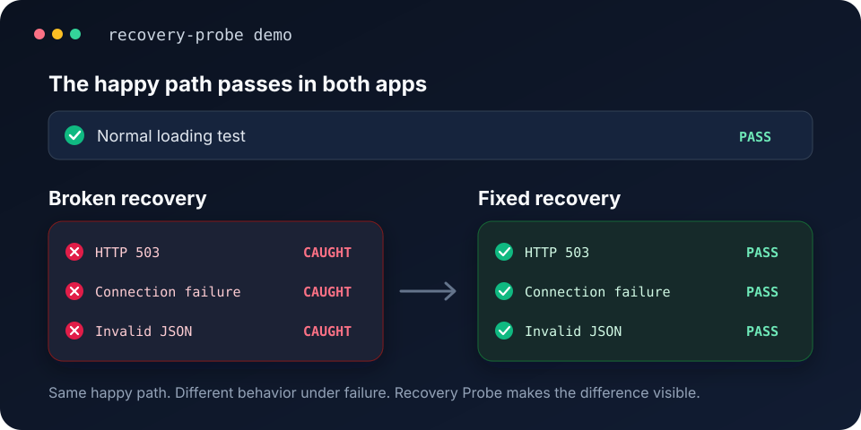

# Recovery Probe

See what your app shows when a data request fails.

Most apps don't crash when a read fails. The list goes empty, the spinner never stops, or the screen keeps showing old data. There's no error and nothing in the logs, so it ships. Recovery Probe fails those reads on purpose, runs the same screen healthy for comparison, and tells you what changed.

[](https://github.com/BojanKovachki/recovery-probe/actions/workflows/validate.yml)
[](https://www.npmjs.com/package/recovery-probe)
[](LICENSE)



## Try it

You need Node.js 22 or newer.

```bash
npm install --save-dev recovery-probe playwright
npx playwright install chromium
npx recovery-probe demo
```

The demo runs two versions of a small app. Both load fine. Only the fixed one survives a 503, a dropped connection and a broken JSON response.

## Check your own app

**Web app.** Start it, then run:

```bash
npx recovery-probe init http://localhost:3000
```

A browser opens. Sign in, go to the screen you care about, and click something that only shows up once its data has loaded. Recovery Probe finds the request behind it, fails it three ways, and tells you whether the data came back.

**Electron app.** Start it with `--remote-debugging-address=127.0.0.1 --remote-debugging-port=9222`, then run `npx recovery-probe init`.

**Electron app that loads data over IPC.** Load the small development-only hook in the main process. `npx recovery-probe doctor` prints the code and the path to load it from. Restart the app with the inspector on, then run `npx recovery-probe init`: it lists the hook's channels, asks which one loads the screen, and fails it in a few ways.

Each run saves an HTML and JSON report. Run the same command again to repeat the check, or add `--fresh` to set it up again. If something's missing, `npx recovery-probe doctor` says what and how to fix it.

## More

| To | Run | Docs |
| --- | --- | --- |
| Fail the read behind a screen without writing assertions | `discover` | [Discovery](docs/discovery.md) |
| Catch stale screens and rows stuck in an old state, without faults | `observe` | [Observe](docs/observe.md) |
| See what users get when Save or Send fails | `action` | [Action check](docs/ipc.md#action-check) |
| Fail an SDK's or a main process's own HTTPS connections | `net` | [Network faults](docs/net.md) |
| Find code that turns a failed read into "no data" | `suspects` | [Suspects](docs/suspects.md) |
| Prove a change fixed it | `compare`, `watch`, `verify` | [Compare](docs/compare.md), [Watch](docs/watch.md), [Verify](docs/verify.md) |

## Use it from a coding agent

`recovery-probe mcp` is an MCP server. Any agent that supports MCP can use it to fail a read and look at the screen before it claims the code handles errors. Most agents take this config:

```json
{
  "mcpServers": {
    "recovery-probe": { "command": "npx", "args": ["recovery-probe", "mcp"] }
  }
}
```

Other config formats and the list of tools are in [MCP](docs/mcp.md).

## Use it in your tests

`withFault` fails matching requests inside a Playwright test:

```js
import { test, expect } from '@playwright/test'
import { withFault } from 'recovery-probe'

test('profile recovers after a 503', async ({ page }) => {
  const stats = await withFault(
    page,
    { match: '**/api/profile', kind: 'http-error', status: 503 },
    async () => {
      await page.goto('http://127.0.0.1:3000/profile')
      await page.getByRole('button', { name: 'Retry' }).click()
      await expect(page.getByTestId('profile-name')).toHaveText('Test User')
    },
  )
  expect(stats.applied).toBe(1)
})
```

If nothing matches, `withFault` throws `FAULT_NOT_TRIGGERED` instead of passing. For code that takes a `fetch` function there's `createFaultFetch`. See [API](docs/api.md).

## How it decides

- Every faulted run has a healthy run right before it, on the same screen, and the report compares the two.
- A result is a pass, a failure or inconclusive. A fault that never fired, an unstable baseline or a path it can't reach is inconclusive, never a pass.
- Some findings, like `SILENT_EMPTY`, are leads. They tell you where to look, not that the code is wrong.
- Exit codes: 0 passed, 1 a check failed, 2 needs review or inconclusive, 3 wrong usage or config, 4 couldn't run.

## Where it works

- Web apps in Chromium, either launched by Recovery Probe or attached through a local debugging port.
- Electron apps, over HTTP in the renderer or over IPC with the hook.
- Native HTTPS clients that use `HTTPS_PROXY`, such as an SDK in the main process. Only whole connections can fail there.
- Android WebViews, experimental.

It doesn't simulate a whole device going offline, WebSocket drops, token expiry, sleep or slow networks.

## Privacy

Reports stay on your machine and there's no telemetry. Request and response bodies aren't recorded, and discovery and observation keep screen text only as hashes. Reports can still contain endpoint paths, selectors, text you picked as a marker and, with `--screenshots`, what was on screen, so check them before you share them. Nothing calls an AI service except the opt-in [repair](docs/repair.md) workflow.

Only test apps and accounts you're allowed to, and keep debugging ports on localhost.

## Docs

[Guided start](docs/start.md) · [Desktop and browsers](docs/desktop.md) · [IPC](docs/ipc.md) · [Discovery](docs/discovery.md) · [Observe](docs/observe.md) · [Refresh](docs/refresh.md) · [Network faults](docs/net.md) · [Android](docs/android.md) · [Suspects](docs/suspects.md) · [Compare](docs/compare.md) · [Watch](docs/watch.md) · [Verify](docs/verify.md) · [MCP](docs/mcp.md) · [API](docs/api.md) · [JSON runner](docs/runner.md) · [CI](docs/ci.md) · [Repair](docs/repair.md) · [Changelog](CHANGELOG.md)

## Contributing

See [CONTRIBUTING.md](CONTRIBUTING.md). Report security issues as described in [SECURITY.md](SECURITY.md).

## License

[MIT](LICENSE) © 2026 Bojan Kovachki
